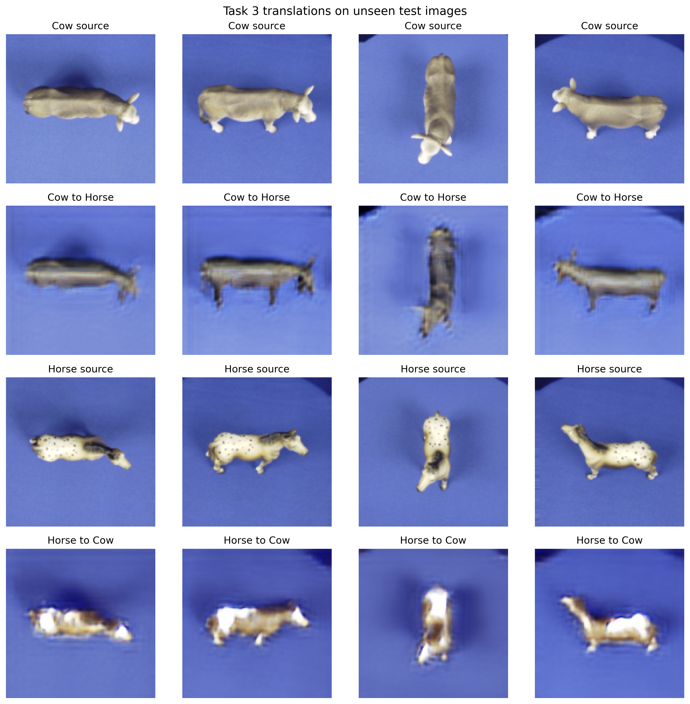

# CNN, GAN Augmentation and CycleGAN on a Cow-Horse Dataset

A PyTorch machine vision project by **Qifeng Liu**, completed at Université Paris-Saclay. It studies classification, synthetic data augmentation, and unpaired image translation in a small-data setting: **82 training images and 82 test images**.

The main models are trained from scratch. The project combines a compact CNN, class-specific GANs starting from random noise, manually curated synthetic samples, and a residual CycleGAN with PatchGAN discriminators.

[Browse the notebook](notebooks/cnn-and-gan.ipynb) · [Report](docs/report.pdf) · [Slides](docs/slides.pdf) · [Complete executed notebook download](https://github.com/flmaple1121/cnn-gan-cow-horse/releases/tag/v1.0.0)

## Recorded results

| Experiment | Overall accuracy | Cow accuracy | Horse accuracy | Added training images |
| --- | ---: | ---: | ---: | --- |
| Task 1: three-seed CNN ensemble | 65.85% | 75.61% | 56.10% | None |
| Task 2: CNN ensemble + selected GAN samples | 67.07% | 75.61% | 58.54% | 12 synthetic horses |

The ensemble averages **per-image logits** from seeds `11`, `21`, and `31`, then predicts the class. It does not average the three accuracy scores. Exact values are saved in [the result tables](results/tables/).

The improvement is **1.22 percentage points**, or **one additional correct prediction out of 82** (54 to 55). These are exploratory course-project results: the test set was inspected during iterative development, and no independent validation split or untouched final hold-out is documented. The numbers do not establish a statistically reliable improvement. CycleGAN results are qualitative.



## What is implemented

- **Task 1 - classification:** three `Conv2d + BatchNorm + ReLU + MaxPool` blocks, global average pooling, and a `64 → 32 → 2` classifier head. Training uses light geometric augmentation, class-weighted cross-entropy with cow:horse weights `1:5`, and a three-seed logit ensemble. Inverse-class-frequency sampling balances the classes after augmentation; real and synthetic horses have the same within-class weight (`synthetic_sample_weight = 1.0`). On the balanced baseline dataset, these sampling weights are uniform.
- **Task 2 - GAN augmentation:** one pure-noise GAN per class, a 100-dimensional latent vector, progressive upsampling and convolution, and a convolutional discriminator. A fixed noise bank supports checkpoint comparisons. Candidates are filtered, exported, visually reviewed, and then used to retrain the same CNN ensemble. The final selection contains **0 cows and 12 horses** and is included with checksums.
- **Task 3 - unpaired translation:** residual generators, PatchGAN discriminators, adversarial/cycle/identity losses, and a replay buffer. Saved figures show translations on both training and test images.

## Repository contents

| Path | Contents |
| --- | --- |
| [`notebooks/cnn-and-gan.ipynb`](notebooks/cnn-and-gan.ipynb) | Main notebook, explanations, saved text/tables, and links to saved image outputs |
| [`src/cnn_and_gan.py`](src/cnn_and_gan.py) | Code-cell export of the main notebook, with editor cell markers |
| [`Newdata/`](Newdata/) | All 164 course-provided input images, label mapping, and SHA-256 manifest |
| [`selected/`](selected/) | The exact 12 manually selected synthetic horses used for the final comparison |
| [`results/`](results/) | Recorded CSV tables, training curves, GAN previews, candidate exports, and translation images |
| [`docs/`](docs/) | Public report/slides, LaTeX sources, presentation notes, and generated assets |
| [`scripts/`](scripts/) | Notebook code export and report-asset generation |

## Run locally

Python 3.11 or 3.12 is recommended. GPU execution is useful for GAN and CycleGAN training.

```bash
git clone https://github.com/flmaple1121/cnn-gan-cow-horse.git
cd cnn-gan-cow-horse
python -m venv .venv
```

Activate the environment (`.venv\Scripts\Activate.ps1` in PowerShell, or `source .venv/bin/activate` on Linux/macOS), then:

```bash
python -m pip install -r requirements.txt
jupyter lab
```

Open `notebooks/cnn-and-gan.ipynb`. The public copy locates `Newdata/` and `selected/` from the repository root or the notebook directory. New outputs go into the ignored `report_outputs/` folder, leaving the recorded `results/` untouched.

For Kaggle, upload the repository data as an input dataset, import the notebook, and enable a GPU. The existing Kaggle input discovery remains available.

### Reuse the saved manual selection

Run setup, dataset inspection, Task 1, and the Task 2 helper/architecture definitions. Skip the code cell that trains the cow and horse GANs, and run the separate **Manual Selection Interface** code cell to retrain with the included `selected/horse/` images. This avoids regenerating the synthetic dataset.

To generate a new selection, run the GAN-training/export cell first, inspect its candidate bank, place accepted images under `selected/cow/` and/or `selected/horse/`, and then run the manual-selection cell. The committed selection and checksums document the historical run; changing that selection defines a new experiment.

The default budgets are 15 CNN epochs per seed, 1,000 GAN epochs per class, and 50 CycleGAN epochs. Running the exported Python file executes all tasks sequentially, including GAN training. The notebook is the convenient interface for skipping or inspecting individual stages.

```bash
python scripts/export_code.py       # regenerate src/cnn_and_gan.py after notebook edits
python scripts/build_report_assets.py
```

To rebuild the PDFs with an installed LaTeX distribution:

```bash
cd docs
latexmk -pdf -interaction=nonstopmode -halt-on-error report.tex
latexmk -pdf -interaction=nonstopmode -halt-on-error slides.tex
```

The [complete executed notebook](https://github.com/flmaple1121/cnn-gan-cow-horse/releases/tag/v1.0.0) preserves the original embedded images. The GitHub-friendly copy externalizes them and adjusts local path discovery. Saved outputs were not produced by a new full training run during publication. No trained model checkpoints were found in the project files; running inference with trained models requires retraining.

## Data and attribution

Training labels are `Train/Cow → 0` and `Train/Horse → 1`. Test labels are `Test/Shape1 → Cow (0)` and `Test/Shape2 → Horse (1)`. Each class has 41 images in each split. Viewpoints are shared across splits, but the animal instances differ.

The raw images were supplied with the machine vision course. An upstream creator and a separate redistribution/reuse license are not identified in the supplied project files. This repository does not assert a new license for those images or a project-wide open-source license. Third-party components retain their own terms; see [third-party notices](THIRD_PARTY_NOTICES.md). Course handouts, local environments, IDE settings, duplicate submission archives, and unrelated tutorial code are excluded.
